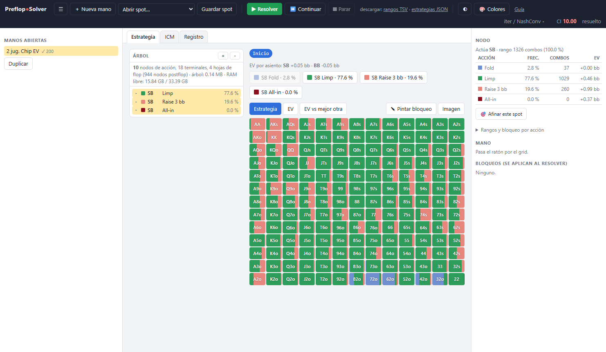
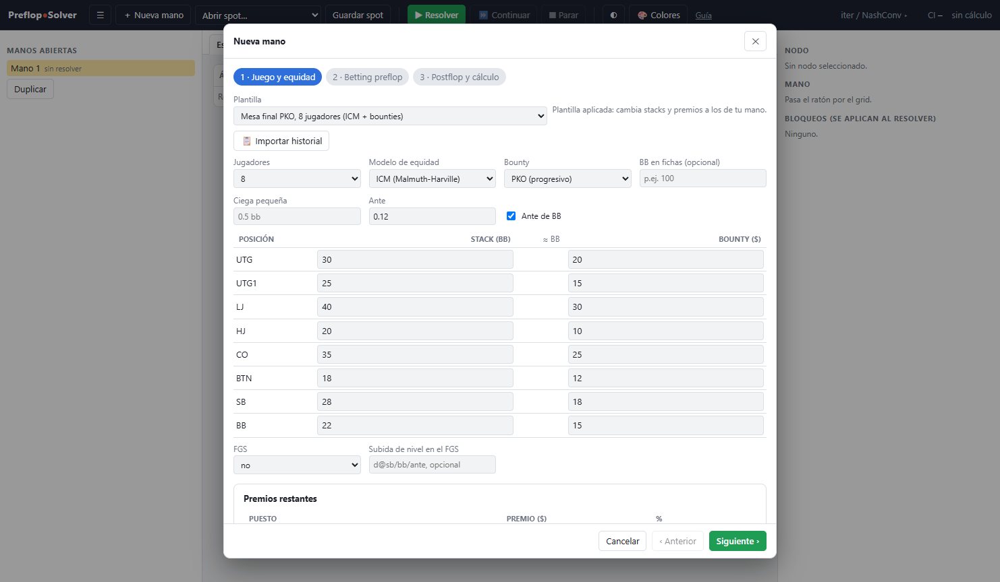
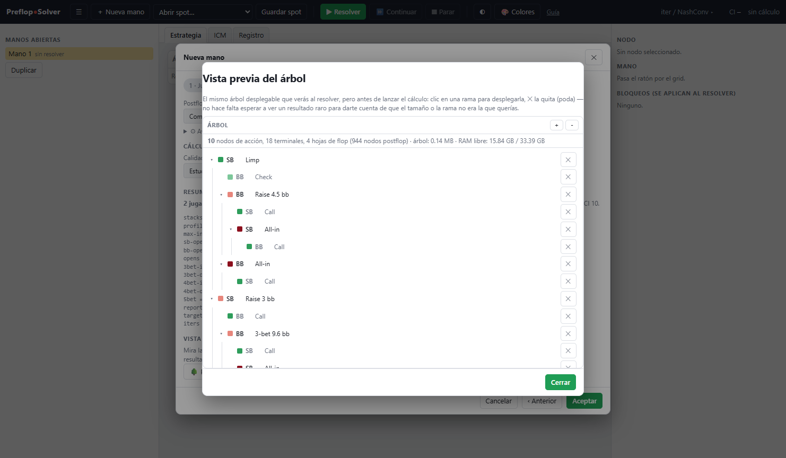
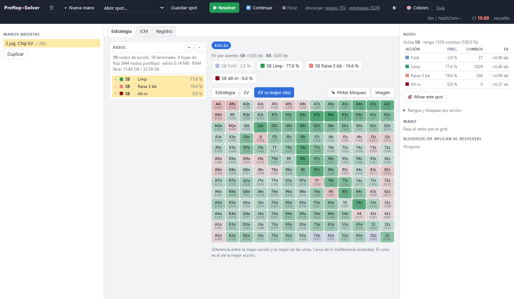
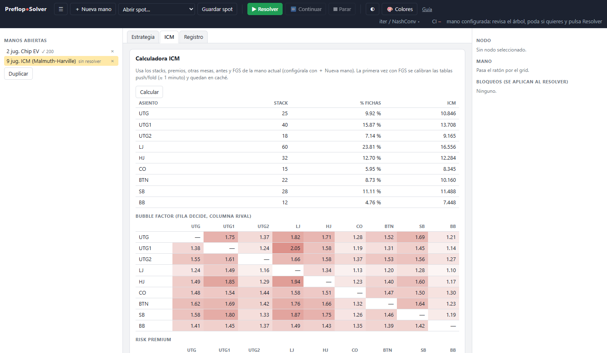

# PreflopSolver

*[English version](README.md)*

Solver preflop de torneos de póquer para Windows: calcula la estrategia de equilibrio de
una mano con stacks, ciegas, antes y premios concretos, en **chip EV**, **ICM** (también
con el resto del torneo) y **PKO**. Lo que pasa después del flop se juega con una
abstracción completa, para que el preflop sepa cuánto vale de verdad ver un flop con cada
mano.

Escrito desde cero en Rust. Portable: se descomprime y se abre, sin instalar nada.



## Qué hace

- **Modelos de premios**: chip EV, ICM, ICM multimesa (otras mesas del torneo), FGS
  (simulación de las manos siguientes para valorar la posición frente a las ciegas) y
  bounties PKO / SKO.
- **Árbol preflop completo**: opens por posición, 3-bet, 4-bet y 5-bet con tamaños en y
  fuera de posición, limps, flats por nivel, umbral de all-in y hasta 6 jugadores por bote
  con botes laterales.
- **Postflop real**: MCCFR con tamaños geométricos, raises, all-in con SPR bajo y botes a
  3 y 4 jugadores, con reducción de varianza.
- **Calidad en vez de iteraciones**: eliges Rápido, Estudio o Referencia y el cálculo
  sigue hasta que la estrategia deja de cambiar.
- **Revisión de manos**: importa historiales de PokerStars, GGPoker y Winamax, con stacks,
  antes y bounties de cada asiento.
- **Plantillas** de spots típicos, vista previa del árbol con poda antes de resolver,
  node locking, calculadora ICM con bubble factors y exportación de rangos.

La lista detallada está en [FEATURES.es.md](FEATURES.es.md).

| Asistente con plantillas | Vista previa del árbol |
|---|---|
|  |  |

| EV frente a la mejor alternativa | Calculadora ICM |
|---|---|
|  |  |

## Descarga y uso

1. Descarga `PreflopSolver.zip` de la página de
   [Releases](https://github.com/PagaLaFanta/PreflopSolver/releases) y descomprímelo.
2. Abre `PreflopSolver.exe`. La interfaz se abre en una ventana propia.
3. **＋ Nueva mano**, elige una plantilla o importa un historial, y pulsa **▶ Resolver**.

La primera vez tarda unos minutos más en arrancar: calcula la equity exacta y otras tablas
y las guarda en `.cache/` para las siguientes.

Toda la documentación de uso está en la **[guía de uso y práctica](docs/GUIA_DE_USO.md)**,
también disponible desde el botón «Guía» de la aplicación.

## Requisitos

- Windows 10 u 11 de 64 bits.
- 8 GB de RAM para casi todo; los árboles más grandes pueden pedir varios GB más.
- Usa todos los núcleos de la CPU. Si el procesador tiene AVX2, se usa automáticamente
  una versión más rápida.

## Compilar desde el código

Hace falta [Rust](https://www.rust-lang.org/tools/install) estable.

```bash
cargo build --release
cargo test --release
```

Binarios en `target/release/`:

| Binario | Para qué |
|---|---|
| `preflop` | Lanzador: abre la interfaz en una ventana propia. |
| `serve` | Servidor local de la interfaz (`http://127.0.0.1:8765/`). |
| `solve` | El motor, también usable desde la línea de comandos (`solve --help`). |

Para generar el paquete de Windows (`dist/PreflopSolver.zip`):

```powershell
powershell -ExecutionPolicy Bypass -File scripts\package.ps1
```

### Línea de comandos

```bash
solve --stacks 10,10 --iters 500                                   # push/fold heads-up, chip EV
solve --stacks 12,18,25,9,15,20 --payouts 50,30,20 --offtable 16x25 # ICM con otras mesas
solve --stacks 25,25,25,25 --profile standard --target-ci 10        # árbol completo hasta CI 10
solve --hh examples/pokerstars_ft.txt --payouts 50,30,20 --html informe.html
solve icm --stacks 20,15,10 --payouts 50,30,20                      # calculadora ICM
```

## Estructura del código

```
src/
├── bin/          solve (CLI), serve (interfaz web local), preflop (lanzador)
├── eval/         evaluador de 7 cartas, equity exacta, showdown, board bunching
├── math/         ICM, ICM multimesa, FGS, valor de los terminales con bounties
├── abstraction/  tamaños geométricos, pool de runouts y buckets por calle
├── tree/         árbol preflop, árboles postflop, arenas cuantizadas
├── cfr/          CFR+ preflop, MCCFR postflop, botes multiway, informes
└── io/           historiales, rangos, exportaciones, informe HTML
ui/               interfaz (HTML y JavaScript sin dependencias) y guía
```

## Licencia

[GPL-3.0](LICENSE). Puedes usarlo, estudiarlo, modificarlo y redistribuirlo, siempre que
las versiones que distribuyas mantengan la misma licencia y publiquen su código.

Este programa se ofrece sin ninguna garantía. Es una herramienta de estudio; usarlo
durante una partida puede estar prohibido por las normas de la sala.
