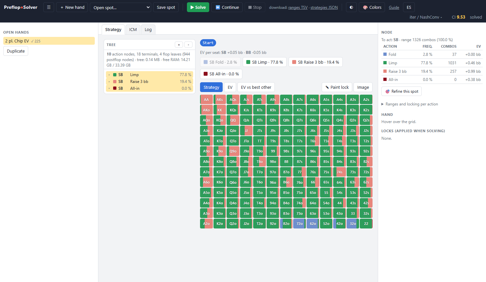
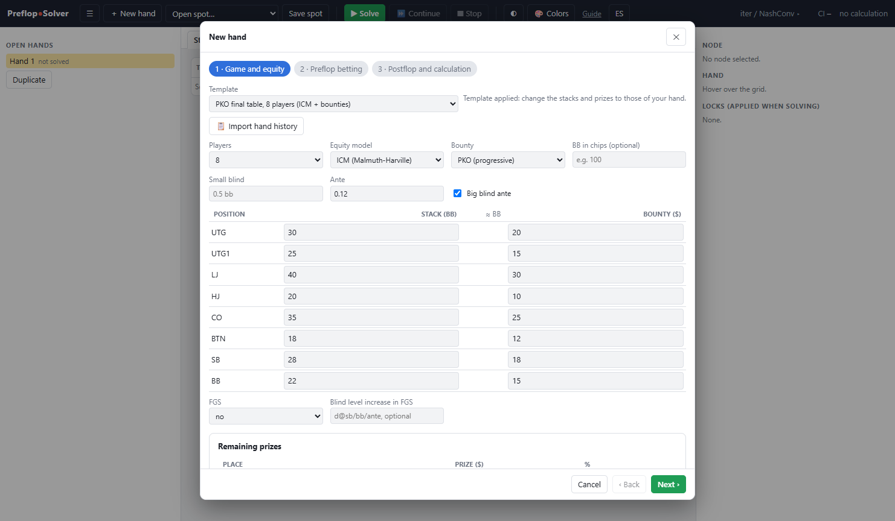
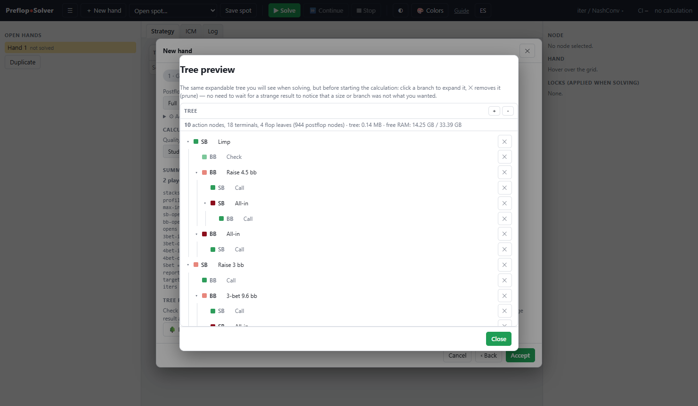
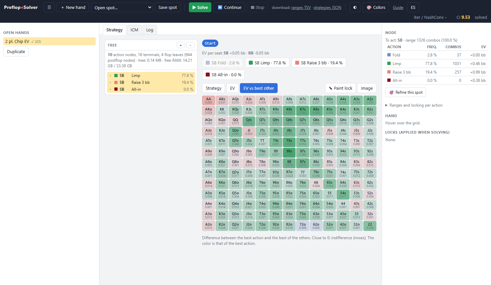
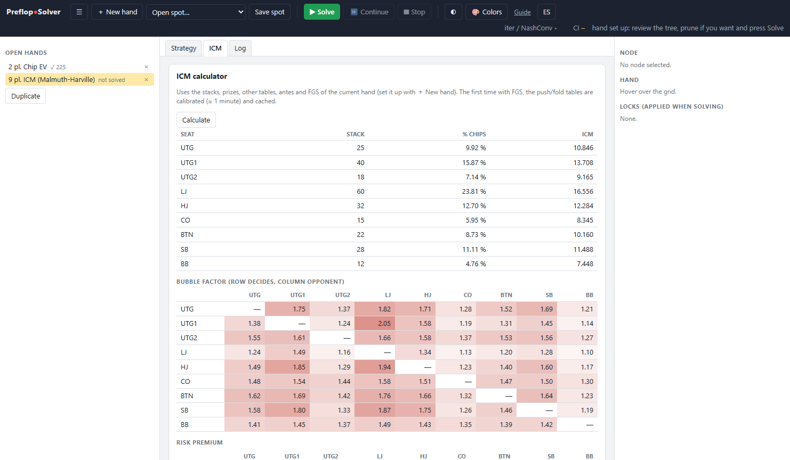

# PreflopSolver

*[Versión en español](README.es.md)*

A preflop poker tournament solver for Windows: it computes the equilibrium strategy of a
hand with specific stacks, blinds, antes and prizes, in **chip EV**, **ICM** (including the
rest of the tournament) and **PKO**. Play after the flop uses a full abstraction, so the
preflop strategy knows how much seeing a flop is really worth with each hand.

Written from scratch in Rust. Portable: unzip and run, nothing to install.



## Features

- **Prize models**: chip EV, ICM, multi-table ICM (other tables of the tournament), FGS
  (simulation of the following hands to value position relative to the blinds) and PKO /
  SKO bounties.
- **Full preflop tree**: opens by position, 3-bets, 4-bets and 5-bets with in-position and
  out-of-position sizes, limps, flats per level, all-in threshold and up to 6 players per
  pot with side pots.
- **Real postflop play**: MCCFR with geometric sizes, raises, all-in at low SPR and 3- and
  4-way pots, with variance reduction.
- **Quality instead of iterations**: pick Quick, Study or Reference and the calculation
  runs until the strategy stops changing.
- **Hand review**: imports PokerStars, GGPoker and Winamax hand histories, with every
  seat's stack, antes and bounty.
- **English and Spanish** interface and guides.
- **Templates** for typical spots, tree preview with pruning before solving, node locking,
  an ICM calculator with bubble factors and range export.

The detailed list is in [FEATURES.md](FEATURES.md).

| Wizard with templates | Tree preview |
|---|---|
|  |  |

| EV vs best alternative | ICM calculator |
|---|---|
|  |  |

> The interface is in English, with a Spanish version one click away (**ES** button in the
> top bar).

## Download and use

1. Download `PreflopSolver.zip` from the
   [Releases](https://github.com/PagaLaFanta/PreflopSolver/releases) page and unzip it.
2. Run `PreflopSolver.exe`. The interface opens in its own window.
3. **＋ New hand**, pick a template or import a hand history, and press **▶ Solve**.

The first run takes a few extra minutes: it computes the exact equity and other tables and
stores them in `.cache/` for later runs.

All usage documentation is in the **[user guide](docs/USER_GUIDE.md)**
([en español](docs/GUIA_DE_USO.md), also available from the «Guide» button in the app).

## Requirements

- 64-bit Windows 10 or 11.
- 8 GB of RAM for almost everything; the largest trees can need several GB more.
- Uses every CPU core. If the processor supports AVX2, a faster build is used automatically.

## Building from source

You need stable [Rust](https://www.rust-lang.org/tools/install).

```bash
cargo build --release
cargo test --release
```

Binaries in `target/release/`:

| Binary | Purpose |
|---|---|
| `preflop` | Launcher: opens the interface in its own window. |
| `serve` | Local server for the interface (`http://127.0.0.1:8765/`). |
| `solve` | The engine, also usable from the command line (`solve --help`). |

To build the Windows package (`dist/PreflopSolver.zip`):

```powershell
powershell -ExecutionPolicy Bypass -File scripts\package.ps1
```

### Command line

```bash
solve --stacks 10,10 --iters 500                                   # heads-up push/fold, chip EV
solve --stacks 12,18,25,9,15,20 --payouts 50,30,20 --offtable 16x25 # ICM with other tables
solve --stacks 25,25,25,25 --profile standard --target-ci 10        # full tree to CI 10
solve --hh examples/pokerstars_ft.txt --payouts 50,30,20 --html report.html
solve icm --stacks 20,15,10 --payouts 50,30,20                      # ICM calculator
```

## Code layout

```
src/
├── bin/          solve (CLI), serve (local web interface), preflop (launcher)
├── eval/         7-card evaluator, exact equity, showdown, board bunching
├── math/         ICM, multi-table ICM, FGS, terminal values with bounties
├── abstraction/  geometric sizes, runout pool and per-street buckets
├── tree/         preflop tree, postflop trees, quantized arenas
├── cfr/          preflop CFR+, postflop MCCFR, multiway pots, reports
└── io/           hand histories, ranges, exports, HTML report
ui/               interface (dependency-free HTML and JavaScript) and in-app guide
```

Code comments are in Spanish.

## License

[GPL-3.0](LICENSE). You may use, study, modify and redistribute it, as long as the versions
you distribute keep the same license and publish their source code.

This program comes with no warranty. It is a study tool; using it during play may be
against a poker site's rules.
